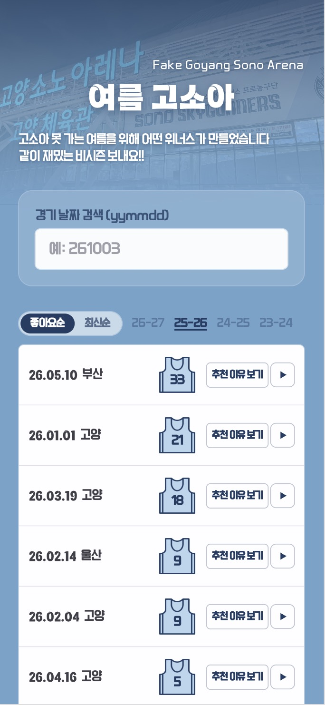
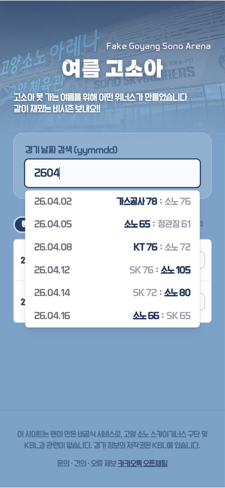
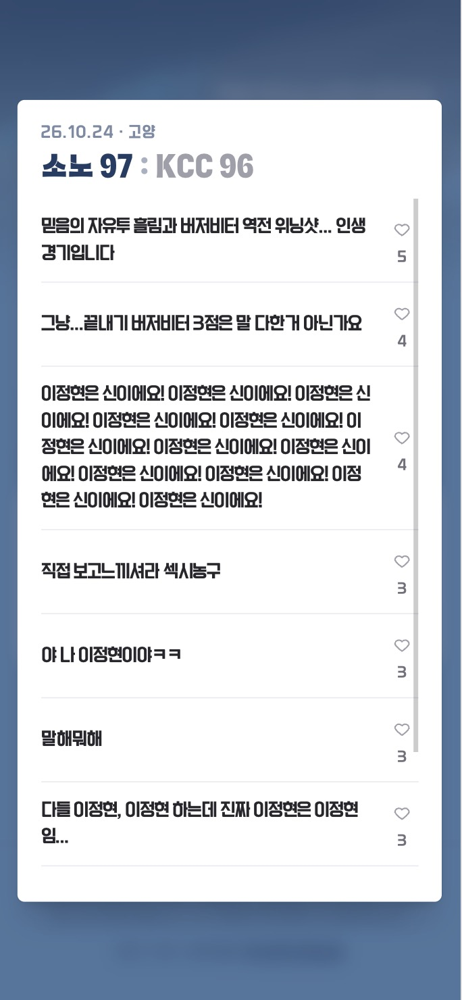
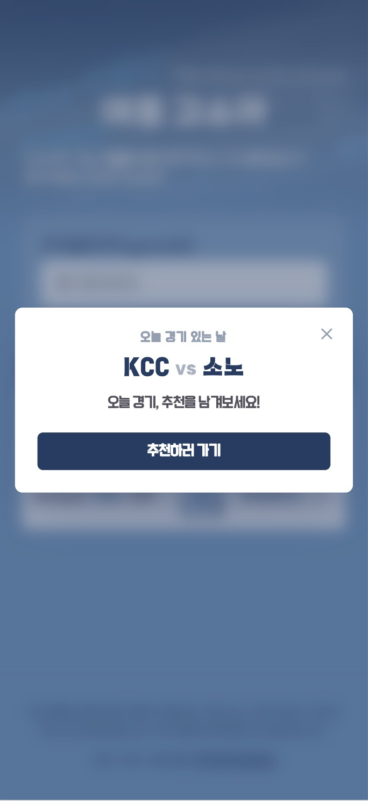
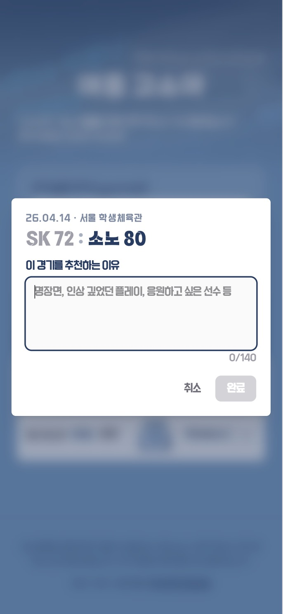

# 🏀 여름고소아 (summer-GOSOA)

> KBL 고양 소노 스카이거너스 팬을 위한 **비시즌 명경기 큐레이션** 서비스.
> 로그인 없이 경기를 검색, 추천, 좋아요하고, 팬들이 남긴 *"이 경기가 명경기인 이유"*를 모읍니다.
>
> **🔗 [summer-gosoa.vercel.app](https://summer-gosoa.vercel.app)** · 1인 기획·개발·배포·운영 · 2026.05 – 운영 중

     

<p align="center">
  
</p>

---

## 소개

비시즌이 되면 팬들은 "그때 그 명경기"를 다시 보려고 유튜브를 헤맵니다. 흩어진 경기를 **한곳에서 찾고, 추천하고, 왜 명경기인지 함께 기록**하는 서비스를 혼자 만들어 배포하고, 런칭 이후 트래킹을 붙여 **5개월간 데이터로 운영·개선**했습니다.

단순한 토이 프로젝트가 아니라, **출시 → 사용자 데이터 관찰 → 원인 진단 → 개선 배포 → 재측정**을 반복한 것이 이 프로젝트의 핵심입니다.

## 핵심 기능

- **멀티시즌 통합 검색** — 날짜(yymmdd) 및 팀으로 4개 시즌 경기를 한 검색창에서
- **로그인 없는 익명 참여** — 경기 추천·좋아요·추천 이유(댓글)를 가입 없이
- **유니폼 좋아요 배지** — 유니폼 실루엣 백넘버 자리에 좋아요 수를 담은 시그니처 UI
- **하이라이트 딥링크** — 경기별 하이라이트 영상으로 바로 이동
- **게임데이 접속 팝업** — 경기일에 오늘 경기 추천을 유도하는 넛지
- **경기 결과 자동 반영** — GitHub Actions 크론으로 스코어 동기화

## 📸 주요 화면

| 🔍 멀티시즌 통합 검색 | 📄 경기 상세 | 📣 게임데이 팝업 | ✍️ 추천 이유 작성 |
|:---:|:---:|:---:|:---:|
|  |  |  |  |
| 날짜·팀으로 4개 시즌을 한 검색창에서 | 좋아요·추천 이유(댓글)·하이라이트 딥링크 | 경기일 넛지 — 작성 전환 가설 실증 장치 | 로그인 없는 익명 참여 |

## 🛠 기술 스택

| 영역            | 사용 기술                                                      |
| --------------- | -------------------------------------------------------------- |
| Frontend        | Next.js 16 (App Router), React 19, TypeScript, Tailwind CSS v4 |
| Backend / DB    | Supabase (PostgreSQL · Row Level Security)                     |
| 배포 / 운영     | Vercel, GitHub Actions                                         |
| 분석 / 모니터링 | Vercel Analytics, Vercel Speed Insights, Microsoft Clarity     |

## 아키텍처 & 기술적 의사결정

- **Supabase 클라이언트 직접 통신 + RLS 정교화** — 1인 개발에서 서버 API 라우트는 오버엔지니어링이라 판단. 익명 `SELECT/INSERT/UPDATE` 정책, `game_date` UNIQUE upsert, `likes >= 0` CHECK로 안전성 확보.
- **낙관적 업데이트(optimistic update)** — 좋아요·추천을 즉시 반영하고 실패 시 롤백해 체감 속도 확보.
- **멀티시즌 무충돌 키 설계** — 시즌 간 경기 날짜가 겹치지 않는 성질을 확인해 `date(yymmdd)`를 그대로 고유 키로 사용(별도 복합키 불필요). 리스트는 선택 시즌만, 검색은 전 시즌 통합.
- **댓글=즉시 / 점수=크론 분리** — 일정 전체를 프리로드해 결과가 없어도 경기 직후 바로 댓글을 쓸 수 있게 하고, 스코어는 크론으로 지연 반영.

## 🔍 트러블슈팅 (표면 증상 ≠ 근본 원인)

- **폰트 500 에러가 사실은 파일 포맷 문제** — `next/font/local`이 죽는 원인이 import가 아니라 `.woff2` 확장자만 붙은 **PostScript Type 1(PFB)** 파일이었음을 매직바이트로 확인, 변환해 해결.
- **인앱 브라우저 데드클릭** — 방문 85%+ 모바일, 카톡/트위터 인앱 브라우저에서 `target="_blank"`가 무시돼 "탭해도 무반응". 사용자 환경 데이터를 근거로 같은 탭 이동으로 수정.
- **반응형 회귀를 눈대중이 아니라 실측으로** — 긴 구장명이 레이아웃을 밀던 문제를 DevTools로 오버플로우(px)를 직접 측정해 고정폭 슬롯·`truncate`로 해결.

## 데이터 기반 운영

감이 아니라 **트래킹을 붙여 매달 숫자를 보고 이상하면 세션 레코딩으로 원인을 파고, 고치고, 다시 쟀습니다.**

- **데드클릭 27.9% → 8.5%** — Clarity로 발견 → 버그/혼란으로 분해 → UI 3종 개선 → 재측정.
- **성능 회귀 진단 → 수정 → 검증** — 리뉴얼(접속 팝업 on-load·시즌 필터·데이터량↑) 후 INP가 9월 242ms에서 **512ms로 회귀**(점수 83.6→78.5)한 것을 10월 데이터에서 포착. 상호작용 지연으로 진단하고 ① `GameCard` `React.memo` + 핸들러 `useCallback`/ref 안정화(바뀐 카드만 리렌더) ② 접속 팝업을 `requestIdleCallback`으로 지연(로드 초기 작업과 분리) ③ Speed Insights 도입(어느 상호작용이 느린지 실측)으로 대응 → 11월 데이터로 효과 검증 중.
- **"유입 문제 vs 기여 전환 문제" 분리 진단** — 4개월 데이터로 병목이 트래픽이 아니라 작성(기여) 전환임을 규명.
- **가설 → 실증** — "쓰기는 경기 직후 감정이 고조된 순간에 나온다"는 가설을 직접 설계한 게임데이 팝업으로 겨냥 → 10월 게임데이에 유기적 새 댓글이 처음 붙으며 4개월 만에 전환 부활.

## 자동화 (GitHub Actions)

- **`keep-supabase-alive.yml`** — 무료 Supabase가 7일 미사용 시 자동 정지되는 문제를 크론 keep-alive로 예방.
- **`update-scores.yml`** — KBL 경기 결과를 매일 수집하고 **변경이 있을 때만 커밋** → no-op 덕에 실제 배포는 경기일에만 발생(동일 효과·더 단순).

## 프로젝트 구조

```
src/
├─ app/            # App Router (layout, page, globals)
├─ components/     # GameCard, SeasonTabs, GameSearchInput, ReasonModal, GameDetailModal …
├─ constants/      # 멀티시즌 일정(schedule-2324 ~ 2627), team-info
├─ lib/            # supabase, highlight, venue, format, schedule-ui
├─ services/       # gameService (데이터 접근)
└─ assets/         # fonts, icons, images
scripts/           # KBL 일정·결과 수집(fetch-kbl*.mjs)
.github/workflows/ # keep-supabase-alive, update-scores
```

## 로컬 실행

```bash
pnpm install
```

`.env.local`에 Supabase 환경변수 설정:

```
NEXT_PUBLIC_SUPABASE_URL=...
NEXT_PUBLIC_SUPABASE_ANON_KEY=...
```

```bash
pnpm dev   # http://localhost:3000
```

---

<sub>개인 프로젝트 / 비공식 팬메이드 서비스입니다.</sub>
